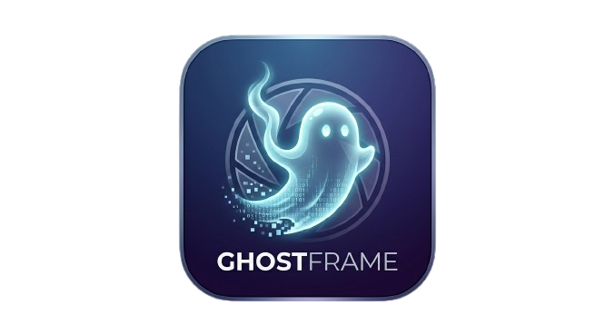

<div align="center">
  
  <h1>GhostFrame</h1>
  <p>
    
    
    
    
    
  </p>
  <p><strong>Compose Stoic Editorial images in your browser.</strong></p>
</div>

GhostFrame is a focused image editor for building quote-led social graphics. Its current Stoic Editorial composition combines a source image with optional filtering, a dark text band, quote and attribution typography, an `@PAGENAME` signature, an accent rule, an optional decorative frame, and an optional circular logo watermark.

Image composition and encoding happen locally in the browser. GhostFrame does not upload image assets as part of its processing workflow. Loading the application itself may still involve network delivery of its HTML, JavaScript, styles, and other application assets, depending on how it is hosted.

## Features

- Main-image upload by picker or drag and drop: JPEG, PNG, or WebP.
- File validation: at most 25 MiB, 12,000 pixels on either edge, and 24 million total pixels.
- Five adjustable looks in addition to the original image: Stoic Dark, Marble, Golden Hour, Noir, and Mist.
- Five bundled fonts: Playfair Display, Montserrat, Lora, Cinzel, and Raleway.
- Quote, attribution, page signature, size, color, position, alignment, overlay, accent, and frame controls.
- Circular watermark from a PNG or WebP, with adjustable size, opacity, and five positions. Transparent artwork generally works best.
- JPEG export with adjustable quality, or PNG export.
- Browser-local drafts and explicitly saved, complete projects.
- Responsive desktop/mobile layout, visible keyboard focus, and native keyboard operation for buttons, fields, switches, sliders, selects, and export-resolution radio controls. The upload button opens the file picker with <kbd>Enter</kbd> or <kbd>Space</kbd>. Hold <kbd>Ctrl</kbd> or <kbd>Command</kbd> while scrolling over the preview to zoom; the on-screen controls also zoom and reset to fit.

## Preview and export

Preview and export use the same logical composition measurement and drawing modules, exposed through the stable `composition.ts` facade. This keeps text, frame, overlay, and watermark placement consistent across output sizes.

The preview is a performance-oriented rendering bounded to a 2,048-pixel edge and 3 million pixels, then displayed at the selected zoom. Its filtered background and composition layout are cached independently. Export does not reuse that preview bitmap: it renders again from the original decoded image at the calculated output dimensions.

Shared geometry does not make preview and export pixel-identical. Preview downsampling, filters operating at different raster resolutions, browser canvas scaling and encoding, and randomized export noise can all produce small visible differences.

### Export sizes

The presets are maximum bounding boxes, not forced dimensions:

| Preset | Maximum box |
|--------|-------------|
| Low | 1080 × 1080 |
| Medium | 1920 × 1080 |
| High | 2048 × 2048 |

The source proportions are preserved while the result is scaled to fill one limiting edge of the selected box. Small images may therefore be enlarged; upscaling does not create additional detail. For example, a 1200 × 800 source exported at Medium becomes 1620 × 1080, while the same source at High becomes 2048 × 1365.

Exports include a subtle randomized pixel-noise pass. This changes pixel values, but it does not establish anonymity or guarantee resistance to perceptual similarity matching, AI detection, moderation, or any other platform system.

## Local persistence

GhostFrame has two separate browser-local storage mechanisms:

### Automatic draft and preferences

After a short delay, `localStorage` automatically saves the quote, attribution, page name, typography and composition options, filter settings, watermark placement/size/opacity, and export preferences. Valid saved values restore automatically when the application opens.

This lightweight snapshot never contains the main image, watermark image bytes, project name, active-project association, preview cache, or zoom. After a normal draft restore, select the image and logo again.

**Reset editor** asks for confirmation, clears this lightweight saved snapshot, restores the editor settings to their defaults, and detaches the current editor from an open saved project. It deliberately keeps the currently selected main image and logo open and does not delete IndexedDB projects.

### Saved projects

The Projects panel uses IndexedDB. A project must be named and have a valid main image before it can be saved. Its record contains the original main-image bytes, optional logo bytes, filenames, and the composition and export settings.

- **Save project** creates a project when none is open, or updates the currently open project.
- **Save as new** duplicates the current composition into a new project record.
- **Open** explicitly loads a saved project's assets and settings; saved projects do not open automatically on startup.
- **Delete** removes the saved record after confirmation but leaves the current composition open.

GhostFrame tracks changes relative to the open project. Opening another project prompts before discarding unsaved changes, and it checks again if the editor changes while an asynchronous open is in progress. This protection applies to project-opening workflows; it is not a general backup or recovery system.

Both storage mechanisms are tied to the current browser profile and site origin. Private-browsing restrictions, storage quotas, clearing site data, browser eviction, or moving to another browser, device, hostname, port, or protocol can make saved work unavailable. Browser-local projects are not backups, cloud sync, portable project files, or account-based storage.

## Privacy and output metadata

The source and logo are decoded, composed, and exported with browser APIs on the user's device; there is no image-upload request in the processing path. A canvas export is a newly encoded JPEG or PNG and does not preserve the original file's EXIF, XMP, GPS, or other source metadata wholesale. Browser encoders may add technical metadata or format structures of their own, so GhostFrame does not promise an absolutely metadata-free file.

GhostFrame makes no guarantee about originality, anonymity, reach, monetization, moderation, duplicate detection, or AI detection. Review exported files with an appropriate inspection tool when a particular platform or metadata requirement matters.

## Getting started

Prerequisites: Node.js 24 and npm. Node 24 matches continuous integration.

```bash
git clone https://github.com/a-ramirezzz/ghostframe.git
cd ghostframe
npm ci
npm run dev
```

Vite prints the local development URL, normally `http://localhost:5173`. GhostFrame has no API keys or application backend. See [CONTRIBUTING.md](CONTRIBUTING.md) for all validation commands.

## Project structure

```text
ghostframe/
├── src/
│   ├── components/       # Editor panels, responsive layout, and canvas preview
│   ├── hooks/            # Image assets, editor state, export, persistence, and projects
│   ├── state/            # Validated localStorage snapshots and IndexedDB projects
│   ├── utils/            # Composition facade/modules, sizing, filters, noise, and encoding
│   ├── assets/fonts/     # Self-hosted font files and declarations
│   └── types/            # Editor types, presets, and available options
├── e2e/                  # Chromium end-to-end coverage
├── tests/                # Shared Vitest setup and fixtures
├── .github/workflows/    # Automated validation
├── CONTRIBUTING.md
├── FONT_LICENSES.md
└── LICENSE
```

## Contributing

Contributions are welcome. Please read [CONTRIBUTING.md](CONTRIBUTING.md) before submitting a change. Bundled font licensing is documented in [FONT_LICENSES.md](FONT_LICENSES.md).

## License

[MIT](LICENSE)
